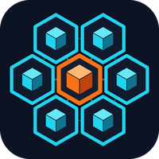
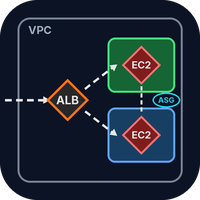
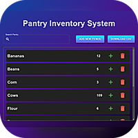
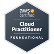
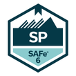

<h1 align="center">Michael Roy</h1>

  <strong>DevOps Engineer | 10+ Years IT & Infrastructure Operations | Kubernetes | Linux | AWS | Automation</strong>

<!-- TODO when Flux, Traefik and Prometheus are live, change the line above to
  DevOps Engineer | Built and operate a 6 node HA k3s cluster on bare metal | Kubernetes, GitOps with Flux, Linux, AWS -->

      
      
      
      
      
   

<h2 align="center">About</h2>

  I run infrastructure for a living and for fun. I spent 10+ years operating and maintaining mission-critical systems in the Army and in IT operations,
  then moved into DevOps through the Code Platoon DevOps program.
    
  Today I build and operate a 6 node highly available k3s cluster (3 control plane and 3 worker nodes) on bare metal at home,
  and a hardened Debian VPS that runs my own self-hosted services.
  I write up what I learn on a weekly blog.

<h2 align="center">What I am working on</h2>

  Homelab platform on k3s, with GitOps for the services I run.
   
  Planned workloads are Mealie, Linkding, Wallabag, Radicale.
   
  Studying for the Certified Kubernetes Application Developer (CKAD) exam.

<!-- TODO when live, add one line per item and link the write-up
  GitOps with Flux
  Ingress with Traefik
  Monitoring with Prometheus and Grafana
-->

<h2 align="center">Latest Blog Posts</h2>

<!-- BLOG-POST-LIST:START -->
- [I Booked My CKAD Exam for January. Here’s My Plan](https://michaelroy.dev/posts/ckad-prep/)
<!-- BLOG-POST-LIST:END -->
 
➡️ <a href="https://michaelroy.dev/posts/">Read more on michaelroy.dev</a>
 
📰 <a href="https://michaelaroy.substack.com">Also on Substack</a>

<h2 align="center">Skills and tools</h2>

<table align="center" width="100%">
  <tr>
    <th align="center">Platform and Infrastructure</th>
    <th align="center">Automation and CI/CD</th>
    <th align="center">Also used</th>
  </tr>
  <tr>
    <td align="center" width="33%">
      
    </td>
    <td align="center" width="34%">
      
    </td>
    <td align="center" width="33%">
      
    </td>
  </tr>
</table>

<!-- TODO add only when true
  Terraform, Ansible (automation)
  Prometheus, Grafana (monitoring)
  Flux (GitOps)
  e.g. https://skillicons.dev/icons?i=terraform,ansible,prometheus,grafana
-->

<h2 align="center">Projects</h2>

<table align="center" width="100%">
  <tr>
    <td align="center" width="50%">
      <strong> Homelab k3s cluster</strong>
       
      6 node HA k3s cluster on bare metal with 3 control plane and 3 worker nodes.
       
      <!-- TODO link when the homelab repo is public and has passed a gitleaks scan
      <a href="https://github.com/its-michaelroy/REPO-NAME">Architecture notes and manifests</a>
      -->
      <em>Repository coming soon.</em>
    </td>
    <td align="center" width="50%">
      <strong><a href="https://github.com/its-michaelroy/twoge_demo" target="_blank"> twoge_demo</a></strong>
       
      Hosted the Twoge application on AWS infrastructure as a DevOps program assessment.
    </td>
  </tr>
  <tr>
    <td align="center" width="50%">
      <strong><a href="https://github.com/its-michaelroy/ValidationStation" target="_blank"> Validation Station</a></strong>
       
      Email and phone validation app built with Django REST Framework, React and PostgreSQL.
    </td>
    <td align="center" width="50%">
      <strong><a href="https://github.com/its-michaelroy/HamStudyX" target="_blank">
       HamStudyX</a></strong>
       
      Crossplatform study app for ham radio license exams, built with .NET MAUI.
    </td>
  </tr>
  <tr>
    <td align="center" width="50%">
      <strong><a href="https://github.com/its-michaelroy/StockSmart-IMS" target="_blank">
       
      StockSmart IMS</a></strong>
       
      Pantry inventory app with full CRUD, built with React, Next.js, MUI and Firebase.
    </td>
    <td width="50%"></td>
  </tr>
</table>

<!-- Optional TODO, one security practice repo with sanitized hardening notes or scripts. Use example.com placeholders and no real configs. -->

<h2 align="center">Background</h2>

  U.S. Army veteran who operated and maintained mission-critical systems in hardened, secure military facilities.
   
  Graduate of Code Platoon (DevOps) and the Microsoft Software and Systems Academy (MSSA).
   
  1st place hackathon team in 2024 with the project Deep Impact.

<h2 align="center">Certifications</h2>

<!--START_SECTION:badges-->

<!--END_SECTION:badges-->

<h2 align="center">GitHub Activity</h2>

  

