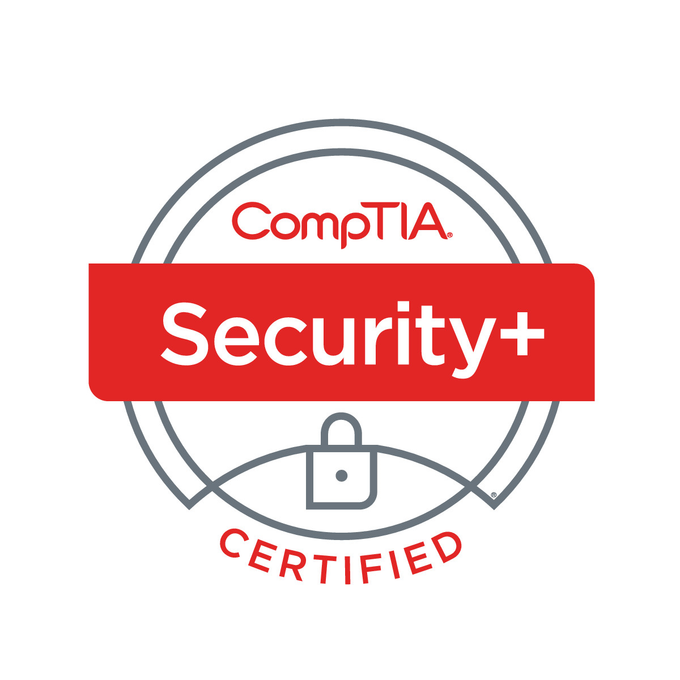
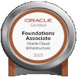

<!--
  Profile README rewrite for DevOps, Platform and Kubernetes roles.
  Rules used here: no emoji, no div elements, blog section in one 
 with no blank lines inside it.
  Anything marked TODO is not true yet. Remove the comment wrapper only when it is true.
  OPSEC: no IPs, hostnames, ports, versions or which services face the internet.
-->

<h1 align="center">Michael Roy</h1>

  <strong>DevOps Engineer | Built and operate a 6 node HA k3s cluster on bare metal | Kubernetes, Linux, Docker, AWS</strong>
   
  Army veteran. 10+ years in IT operations. CompTIA Security+ and AWS Certified Cloud Practitioner. CKAD in progress.

<!-- TODO when Flux, Traefik and Prometheus are live, change the line above to
  DevOps Engineer | Built and operate a 6 node HA k3s cluster on bare metal | Kubernetes, GitOps with Flux, Linux, AWS -->

  <a href="https://michaelroy.dev/">Independent Infrastructure Labs (michaelroy.dev)</a>
  |
  <a href="https://www.linkedin.com/in/michaelroy91">LinkedIn</a>
  |
  <a href="https://michaelaroy.substack.com/">Substack</a>
  |
  <a href="mailto:michael@michaelroy.dev">michael@michaelroy.dev</a>

<h2 align="center">About</h2>

  I run infrastructure for a living and for fun. I spent 10+ years operating and maintaining mission-critical systems in the Army and in IT operations,
  then moved into DevOps through the Code Platoon DevOps program, and I am a current KubeCraft student.
    
  Today I build and operate a 6 node highly available k3s cluster (3 control plane and 3 worker nodes) on bare metal at home,
  and a hardened Debian VPS that runs my own self-hosted services with SSH reachable only over Tailscale and DNS on Cloudflare.
  I write up what I learn on my blog, with sensitive details left out on purpose.

<h2 align="center">What I am working on</h2>

  Homelab platform on k3s, with GitOps for the services I run.
   
  Planned workloads are Mealie, Linkding, Wallabag, Radicale and LibreTranslate.
   
  Studying for the Certified Kubernetes Application Developer (CKAD) exam.

<!-- TODO when live, add one line per item and link the write-up
  GitOps with Flux
  Ingress with Traefik
  Monitoring with Prometheus and Grafana
-->

<h2 align="center">Latest writing</h2>

<!-- BLOG-POST-LIST:START --><a href="https://michaelroy.dev/posts/">Read the blog on michaelroy.dev</a> 
<!-- BLOG-POST-LIST:END -->
<a href="https://michaelroy.dev/posts/">All posts</a> | <a href="https://michaelaroy.substack.com/">Substack</a>

<h2 align="center">Skills and tools</h2>

<table align="center" width="100%">
  <tr>
    <th align="center">Platform and Infrastructure</th>
    <th align="center">Automation and CI/CD</th>
    <th align="center">Also used</th>
  </tr>
  <tr>
    <td align="center" width="33%">
      
       
      k3s, Tailscale, Coolify, Traefik (VPS)
    </td>
    <td align="center" width="34%">
      
    </td>
    <td align="center" width="33%">
      
    </td>
  </tr>
</table>

<!-- TODO add only when true
  Terraform, Ansible (automation)
  Prometheus, Grafana (monitoring)
  Flux (GitOps)
  e.g. https://skillicons.dev/icons?i=terraform,ansible,prometheus,grafana
-->

<h2 align="center">Projects</h2>

<table align="center" width="100%">
  <tr>
    <td align="center" width="50%">
      <strong>Homelab k3s cluster</strong>
       
      6 node HA k3s cluster on bare metal with 3 control plane and 3 worker nodes.
       
      <!-- TODO link when the homelab repo is public and has passed a gitleaks scan
      <a href="https://github.com/its-michaelroy/REPO-NAME">Architecture notes and manifests</a>
      -->
      <em>Repository coming soon.</em>
    </td>
    <td align="center" width="50%">
      <strong><a href="https://github.com/its-michaelroy/twoge_demo">twoge_demo</a></strong>
       
      Hosted the Twoge application on AWS infrastructure as a DevOps program assessment.
    </td>
  </tr>
  <tr>
    <td align="center" width="50%">
      <strong><a href="https://github.com/its-michaelroy/ResumeGenerator">ResumeGenerator</a></strong>
       
      Resume PDF generator written in C# with QuestPDF.
    </td>
    <td align="center" width="50%">
      <strong><a href="https://github.com/its-michaelroy/HamStudyX">HamStudyX</a></strong>
       
      Cross-platform study app for ham radio license exams, built with .NET MAUI.
    </td>
  </tr>
  <tr>
    <td align="center" width="50%">
      <strong><a href="https://github.com/its-michaelroy/StockSmart-IMS">StockSmart IMS</a></strong>
       
      Pantry inventory app with full CRUD, built with React, Next.js, MUI and Firebase.
    </td>
    <td width="50%"></td>
  </tr>
</table>

<!-- Optional TODO, one security practice repo with sanitized hardening notes or scripts. Use example.com placeholders and no real configs. -->

<h2 align="center">Background</h2>

  U.S. Army veteran who operated and maintained mission-critical systems in hardened, secure military facilities.
   
  Graduate of Code Platoon (DevOps) and the Microsoft Software and Systems Academy (MSSA).
   
  Current student at KubeCraft.
   
  1st place hackathon team in 2024 with the project Deep Impact.

<!-- TODO confirm the military facility wording against your own non-disclosure obligations before publishing. -->
<!-- TODO confirm the hackathon line. Remove it if you would rather not list it. -->

<h2 align="center">Certifications</h2>

<!--START_SECTION:badges-->

<!--END_SECTION:badges-->

<!-- TODO optional, swap the Security+ link for a Credly verification URL if you have one. -->

  CKAD is in progress and is not listed as earned.

<!--
  Optional stats, use only the Action-committed SVG (no third-party calls). Drop lang-stats.svg because it is C# and JavaScript heavy.
  

-->
